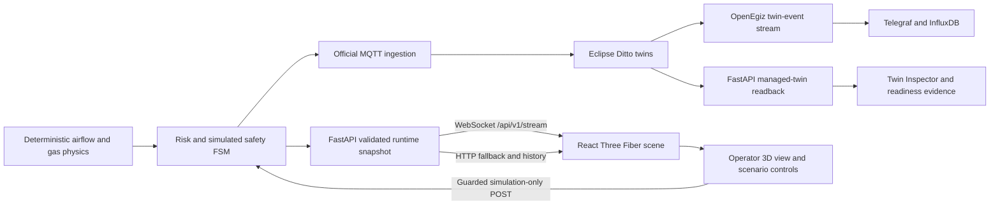

# 3D operational twin

MineGuard X renders the existing OpenEgiz-connected simulation as an interactive
spatial view. The renderer is a consumer of the validated API contract; it is
not a second simulator and it never writes directly to equipment or Eclipse
Ditto.

## Live data path

The live scene and trend buffer use the deterministic runtime snapshot so a
slow platform call cannot block the physics clock. That same runtime state is
published to Ditto. The header reports platform configuration and last
publication status separately, while the Twin Inspector reads managed entities
back from Ditto. This distinction prevents a local value from being presented
as platform readback evidence.

The scene maps the six topology coordinates into a compact three-dimensional
coordinate system. Depth is preserved as a relative vertical offset. Each
airway is drawn between its actual source and target zone from
`mine_topology.json`; the visual cannot add an unmodelled route.

## Visual semantics

| Element | Live source | Meaning |
| --- | --- | --- |
| Zone gas particles | `methane_fraction` | A stable zone-seeded cloud increases visible particle count and opacity with methane concentration; display is percent volume. |
| Zone beacon/light | `risk.state` | Cyan normal, yellow advisory, amber warning, red emergency, purple unknown data. |
| Airway particles | `flow_m3s` | Direction follows topology and animation speed scales with calculated flow; zero flow stops motion. |
| Fan rotor and label | `actual_speed_fraction`, `actual_speed_rpm` | Rotation follows dimensionless feedback; the label shows modeled RPM; zero speed or a fault stops the rotor. |
| Zone CO | `co_ppm` | The selected-zone inspector, top KPI, and trend annotation show validated ppm without deriving it from methane. |
| Lockout modal | `safety[]` | Shows simulated production stop and evacuation advisory reason codes. |
| Trend chart | bounded snapshot history | Methane and airflow share a time axis with configured warning references. |

The graphics never convert stale or missing readings to zero-safe status.
`UNKNOWN_DATA` remains visually distinct and higher priority than advisory or
warning states. When the browser feed becomes stale, the rendered zones use the
effective `UNKNOWN_DATA` state even if the last received snapshot was normal.

## Performance and resilience

- Geometry is procedural, so startup does not depend on external model assets.
- Repeated airflow particles use GPU instancing.
- Device pixel ratio is capped at 1.5 for predictable integrated-GPU load.
- The Three.js bundle is lazy-loaded after WebGL capability detection.
- The API streams one snapshot per second; HTTP polling remains the fallback.
- The client accepts monotonic ticks, detects a reset, bounds local history, and
  reconnects after a closed or silent WebSocket.
- The selectable 2D topology preserves airway direction, live flow, zone
  selection, gas/risk readings, and keyboard operation; it is automatic without WebGL.
- `prefers-reduced-motion` disables continuous fan, particle, beacon, and camera
  damping animation while retaining the current values and risk colours.

## Verified telemetry boundary

The implemented contract covers methane, CO ppm, calculated airflow, fan speed
fraction/RPM, fan power/fault state, risk, freshness, and simulated safety
actions. The October 23 M10 gate validated those fields through source tests,
WebSocket frames, Eclipse Ditto readback, and the served browser UI. None are
derived from an unrelated display value.

## Industrialization boundary

This competition build is an industrial-style simulation, not a certified mine
safety system. A field deployment must replace fictional geometry and parameters
with surveyed and commissioned data, integrate through an approved OT gateway,
add authentication and authorization, use redundant brokers and historians,
define alarm management and change-control procedures, and pass hazard analysis,
cybersecurity review, site acceptance, and the jurisdiction's safety approval.
The current lockout and evacuation actions remain simulation-only by design.
