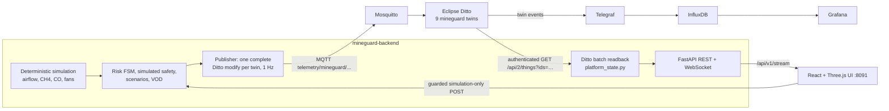

# MineGuard X architecture

MineGuard X is an overlay on the official OpenEgiz v1.0.4 Compose deployment.
It adds two containers, `mineguard-backend` and `mineguard-ui`
(`mineguard/deploy/compose.mineguard.yml`), and reuses the platform's MQTT,
Eclipse Ditto, Telegraf, InfluxDB and Grafana services unchanged.

## Data flow

1. The simulation advances every 0.5 s (`app/simulation/runtime.py`): a
   quadratic fan/airway network, then conservative well-mixed transport for
   methane and CO, then risk and simulated safety decisions.
2. Every two ticks (1 s), the publisher thread converts the latest snapshot into
   a complete `modify /features` Ditto protocol message for each of the 16
   twins (`app/integrations/telemetry.py`). It publishes them to MQTT
   `telemetry/mineguard/<thing>`, the official OpenEgiz ingestion path.
3. The publisher then reads all 16 twins back from Ditto in one authenticated
   request. It accepts the readback only when every twin carries the same
   publication run ID and tick, and rebuilds the UI state contract from the
   Ditto JSON (`app/integrations/platform_state.py`, publication status
   `ECLIPSE_DITTO_READBACK`).
4. `GET /api/v1/state`, `/api/v1/history` and the `/api/v1/stream` WebSocket
   serve that Ditto-derived state. The UI therefore displays platform data, not
   the simulator's memory. Without a configured platform (unit tests only),
   the API serves the local model state, labelled `LOCAL_MODEL_SNAPSHOT`.
5. Ditto republishes twin events; Telegraf stores them in InfluxDB (bucket
   `default`, measurement `mqtt_consumer`), where the official Grafana can
   query them.

The physics clock and the platform I/O run on separate threads. Slow Ditto
responses show up as readiness errors (`DITTO_READBACK_STALE`,
`DITTO_PUBLICATION_UNVERIFIED`); they never freeze the model.

## Controls

Scenario commands (`start`, `pause`, `resume`, `reset`) change only the
simulation. They require the header `X-MineGuard-Simulation: SIMULATION_ONLY`
and an allowed Origin. The VOD controller and the decision trace are computed
on the controller's model state. Their outputs are proposals until the
operator presses *Apply recommendation (simulated)* (`POST /api/v1/vod/apply`,
re-validated against the current safety state). At EMERGENCY the safety state
machine commands the fan response itself. Fan commands are reached through a
5 %/s drive ramp, and the Z04 cutting machine stops while its zone's simulated
`trip_power` is set. Nothing in the system has an equipment interface.

## Twin schema

| Thing | Features |
|---|---|
| `mineguard:mine-01` | `max_methane`, `max_co`, `total_airflow`, `fan_power`, `simulation` (tick, seconds, paused), `idSimulationRun`; attributes list all zones, airways and fans |
| `mineguard:airway-e01`…`e06` | `flow` (m³/s), `obstruction` (resistance multiplier, OPEN/RESTRICTED), `simulation`, `idSimulationRun`; attributes `from_zone_id`, `to_zone_id`, length, resistance, design flow, fans |
| `mineguard:zone-z01`…`z06` (attributes: volume, depth, inflow/outflow airways, upstream/downstream zones, fans, sensors) | `methane` (% volume), `co` (ppm), `airflow` (m³/s), `risk` (state, reason codes, quality, transitioned), `safety_interlock` (trip_power, evacuation, ventilation, optimization, fan requests, `equipment_io: false`), `simulation`, `idSimulationRun` |
| `mineguard:fan-main`, `fan-aux` | `speed`, `requested_speed` (% rated), `rpm`, `power` (kW), `state`, `simulation`, `idSimulationRun` |
| `mineguard:shearer-z04` | `state` (RUNNING/TRIPPED), `power` (kW), `cutting_methane`, `exhaust_co` (m³/s), `simulation`, `idSimulationRun`; attributes: zone, operating power, emission rates, interlock source |

Twins use the platform's `default:basic_policy`. They are created idempotently
by `bootstrap_twins.py`, which refuses to overwrite unmanaged things.

## Security

Generated platform credentials stay in the git-ignored `deploy/compose/.env`
and reach only the backend container through Compose. The browser talks only to
the same-origin nginx proxy, which carries a strict Content-Security-Policy. Both
containers run as non-root with read-only file systems, `no-new-privileges`, all
capabilities dropped, and memory limits.
